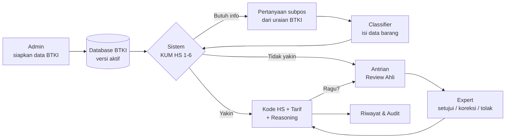
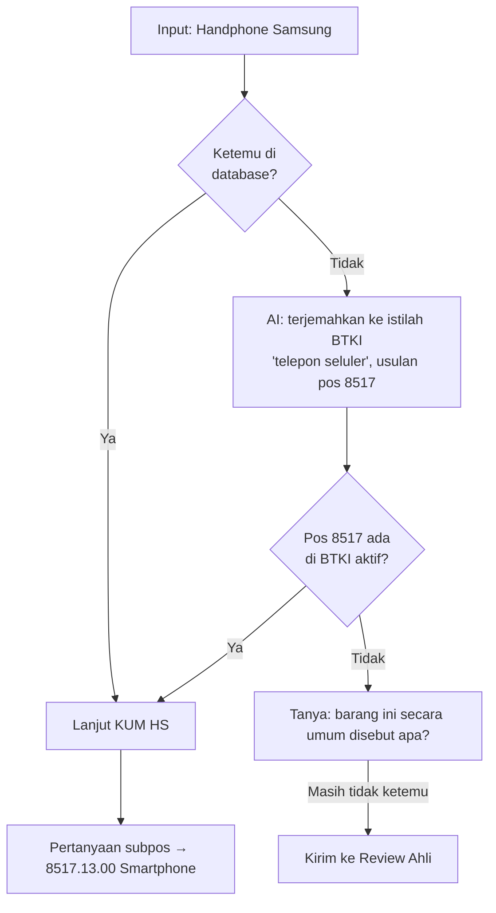
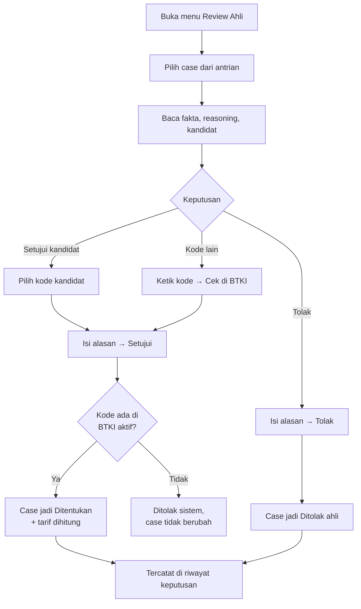
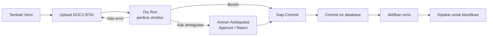
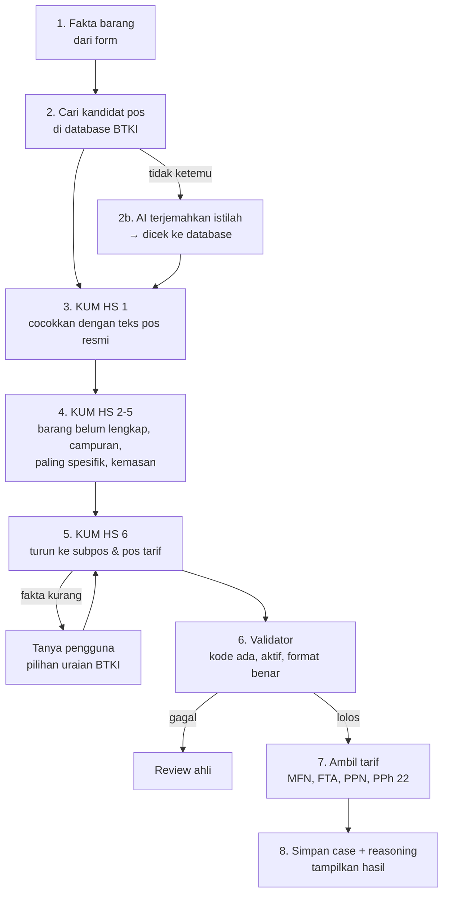

# AI HS Classification Intelligence V2 — Flow Bisnis & Flow Sistem

Dokumen ini menjelaskan cara kerja aplikasi dari sisi pengguna: siapa melakukan apa, apa yang terjadi di balik layar, dan apa hasilnya. Ditulis untuk bahan presentasi, bukan dokumen teknis.

Tempat screenshot ditandai dengan kotak **[SCREENSHOT]**. Ganti baris komentar `<!--  -->` di bawahnya dengan gambar Anda.

---

## 1. Ringkasan Satu Paragraf

Pengguna mengisi data barang. Sistem mencari pos yang cocok di **database BTKI 2022**, menjalankan **KUM HS 1–6**, lalu menanyakan pilihan subpos berdasarkan **uraian resmi BTKI** bila fakta belum cukup. Hasil akhirnya adalah kode HS 8 digit, tarif (MFN, FTA, PPN, PPh 22), dan jejak reasoning yang bisa diaudit. Kalau sistem tidak yakin, case dikirim ke **ahli kepabeanan** untuk diputuskan. Admin menjaga data BTKI tetap benar dan berlaku.

---

## 2. Prinsip yang Dipegang Sistem

| Prinsip | Artinya bagi pengguna |
|---|---|
| Kode HS selalu dari database BTKI | Tidak ada kode "karangan". Setiap kode yang tampil benar-benar ada di BTKI yang berlaku. |
| AI hanya penerjemah istilah | AI dipakai bila nama barang tidak dikenal (mis. "handphone"). AI tidak pernah menentukan kode final. |
| Tidak menebak | Bila fakta kurang, sistem bertanya atau meminta ahli. Sistem tidak memilih subpos "default". |
| Semua keputusan tercatat | Setiap langkah, jawaban pengguna, dan keputusan ahli tersimpan dan bisa dilihat ulang. |
| Hak akses per peran | Setiap orang hanya melihat dan melakukan yang sesuai perannya. |

---

## 3. Peran Pengguna

| Peran | Tugas utama | Menu yang terlihat |
|---|---|---|
| **Classifier** (petugas klasifikasi) | Mengklasifikasi barang, menjawab pertanyaan, meminta review ahli | Klasifikasi, Riwayat |
| **Expert Reviewer** (ahli kepabeanan) | Memutuskan case yang perlu review: setujui, koreksi, atau tolak | Klasifikasi, Riwayat, Review Ahli |
| **Admin** | Semua di atas, plus mengelola data BTKI dan versinya | Semua menu, termasuk Admin Data Center |
| **Viewer** | Melihat riwayat miliknya saja | Riwayat |

> **[SCREENSHOT 01 — Halaman Login]**
> Ambil: halaman login dengan kolom Email dan Password.
<!--  -->

> **[SCREENSHOT 02 — Header & menu per peran]**
> Ambil: header setelah login sebagai Admin (semua menu tampil). Opsional: bandingkan dengan login Classifier.
<!--  -->

---

## 4. Gambaran Besar Alur End-to-End



Tiga alur utama:
1. **Alur Classifier** — mengklasifikasi barang (bagian 5).
2. **Alur Expert** — memutuskan case yang sulit (bagian 6).
3. **Alur Admin** — menjaga data BTKI (bagian 7).

---

## 5. Alur Classifier: Mengklasifikasi Barang

### 5.1 Langkah demi langkah

| # | Pengguna melakukan | Sistem melakukan |
|---|---|---|
| 1 | Login, buka menu **Klasifikasi** | Menampilkan form Data Barang |
| 2 | Mengisi nama dagang, nama generik, fungsi, kondisi, material, dll. Klik **Analisis HS Code** | Mengubah isian menjadi fakta barang |
| 3 | — | Mencari pos (heading 4 digit) yang cocok di database BTKI |
| 4 | — | Bila tidak ketemu: AI menerjemahkan nama barang ke istilah BTKI, lalu hasilnya dicek ulang ke database |
| 5 | — | Menjalankan KUM HS 1–5 untuk mengunci satu pos |
| 6 | Bila muncul pertanyaan: memilih subpos yang sesuai (pilihan diambil dari uraian resmi BTKI) | Menjalankan KUM HS 6: turun dari pos → subpos → pos tarif 8 digit, setingkat demi setingkat |
| 7 | — | Memvalidasi kode ke database (harus ada, aktif, format benar) |
| 8 | Melihat hasil | Menampilkan kode HS, uraian resmi, confidence, tarif, dan reasoning |
| 9 | Opsional: klik **Minta Expert Review** bila ragu | Case masuk antrian ahli |

> **[SCREENSHOT 03 — Form Data Barang terisi]**
> Contoh isian: Nama dagang `Komatsu PC200`, Nama generik `excavator`, Fungsi `Menggali/Earthmoving`, Kondisi `Lengkap dan jadi`.
<!--  -->

### 5.2 Pertanyaan subpos (KUM HS 6)

Bila fakta di form belum cukup untuk memilih pos tarif, sistem **bertanya**, bukan menebak. Pilihan jawabannya adalah uraian resmi BTKI dari subpos yang setingkat. Pengguna cukup memilih yang paling sesuai.

Contoh excavator:

```
Pertanyaan 1 — Pos 8429. Uraian subpos mana yang paling sesuai?
  ( ) 8429.1 — Buldoser dan angledoser
  ( ) 8429.2 — Grader dan mesin perata
  ( ) 8429.3 — Mesin pengikis
  ( ) 8429.4 — Mesin pemadat dan mesin gilas jalan
  (•) 8429.5 — Sekop mekanik, ekskavator dan shovel loader
  ( ) Tidak ada yang sesuai / tidak yakin — minta review ahli

Pertanyaan 2 — Sekop mekanik, ekskavator dan shovel loader
  ( ) 8429.51 — Front-end shovel loader
  (•) 8429.52 — Mesin yang berputar 360° di atas dasarnya
  ( ) 8429.59 — Lain-lain

Hasil: 8429.52.00
```

> **[SCREENSHOT 04 — Banner pertanyaan subpos]**
> Ambil: banner kuning dengan pilihan radio uraian BTKI (pertanyaan pertama excavator).
<!--  -->

### 5.3 Barang dengan nama pasar / merek (bantuan AI)

BTKI memakai istilah resmi, sedangkan pengguna sering memakai nama sehari-hari. Contoh: pengguna menulis **"Handphone Samsung Galaxy"**, padahal di BTKI tertulis **"Perangkat telepon … untuk jaringan seluler"**.



- AI hanya dipanggil bila database tidak menemukan apa pun. Barang yang sudah dikenal tidak memakai AI.
- Usulan AI selalu dicek ulang ke database. Usulan yang tidak ada di BTKI dibuang.
- Langkah AI tercatat di reasoning dengan label `AI_SUGGESTION`.
- Bila layanan AI sedang tidak tersedia, sistem memberi tahu ("Asisten AI sedang tidak tersedia… konsultasikan dengan ahli kepabeanan bila ragu") lalu tetap melanjutkan dengan menanyakan nama generik.
- Merek (Samsung, Dell, Komatsu) diabaikan, karena merek bukan dasar penggolongan HS.

> **[SCREENSHOT 05 — Reasoning dengan langkah AI_SUGGESTION]**
> Ambil: panel Reasoning KUM HS untuk "Handphone Samsung Galaxy", tampak langkah AI_SUGGESTION di urutan pertama.
<!--  -->

### 5.4 Hasil klasifikasi

Panel hasil menampilkan:
- **Kode HS 8 digit** dan **uraian resmi BTKI**;
- **Confidence** (Tinggi / Sedang / Rendah);
- **Tarif & Pajak Impor**: Bea Masuk MFN, PPN, PPh 22, dan daftar tarif FTA yang tersedia, masing-masing dengan sumbernya;
- **Disclaimer**: tarif FTA hanya referensi ketersediaan (kelayakan tergantung ketentuan asal barang), dan PPN/PPh 22 adalah tarif standar (fasilitas PMK tidak dihitung);
- **Reasoning KUM HS**: setiap langkah bisa dibuka untuk melihat alasan dan sumber hukumnya.

> **[SCREENSHOT 06 — Panel hasil lengkap]**
> Ambil: hasil 8429.52.00 atau 8517.13.00, terlihat kode, uraian, confidence, dan bagian tarif.
<!--  -->

> **[SCREENSHOT 07 — Reasoning KUM HS dibuka]**
> Ambil: satu langkah reasoning yang di-expand, terlihat alasan dan source ID.
<!--  -->

### 5.5 Kemungkinan hasil

| Status | Artinya | Yang dilakukan pengguna |
|---|---|---|
| **Ditentukan** | Kode final sudah pasti dan lolos validasi | Pakai hasilnya, atau minta review ahli bila ragu |
| **Perlu klarifikasi** | Sistem butuh satu jawaban lagi | Jawab pertanyaan di banner kuning |
| **Review ahli** | Sistem tidak bisa memutuskan dengan aman | Tunggu keputusan ahli; pantau di Riwayat |
| **Ditolak ahli** | Ahli menolak rekomendasi (mis. data barang tidak memadai) | Baca alasan, perbaiki data, klasifikasi ulang |

> **[SCREENSHOT 08 — Hasil "Belum dapat ditentukan otomatis"]**
> Ambil: contoh case yang masuk review ahli, terlihat kandidat untuk ditinjau.
<!--  -->

> **[SCREENSHOT 09 — Tombol "Minta Expert Review"]**
> Ambil: kotak alasan setelah tombol diklik.
<!--  -->

### 5.6 Riwayat klasifikasi

Menu **Riwayat** menyimpan semua klasifikasi. Pengguna bisa:
- mencari berdasarkan nama barang atau kode HS;
- menyaring berdasarkan status dan rentang tanggal;
- membuka ulang case lama lengkap dengan fakta, reasoning, tarif, dan riwayat keputusan ahli.

Classifier dan Viewer hanya melihat case miliknya. Admin dan Expert melihat semua case.

> **[SCREENSHOT 10 — Halaman Riwayat]**
> Ambil: daftar case di kiri dan detail case di kanan.
<!--  -->

---

## 6. Alur Expert Reviewer: Memutuskan Case Sulit

### 6.1 Kapan case masuk antrian ahli?

- Sistem tidak menemukan pos yang cocok, termasuk setelah bantuan AI;
- Pengguna memilih "Tidak ada yang sesuai / tidak yakin";
- KUM HS 4 (barang paling mirip) dipakai, karena ini berisiko tinggi;
- Pengguna sengaja menekan **Minta Expert Review**.

### 6.2 Langkah demi langkah



| # | Expert melakukan | Sistem melakukan |
|---|---|---|
| 1 | Buka menu **Review Ahli** | Menampilkan semua case berstatus "Review ahli" |
| 2 | Pilih satu case | Menampilkan fakta barang, reasoning, dan kandidat dari sistem |
| 3 | Pilih kode kandidat, **atau** ketik kode lain lalu klik **Cek di BTKI** | Menampilkan uraian resmi kode tersebut, atau "tidak ditemukan" |
| 4 | Isi **alasan** (wajib), lalu klik **Setujui** atau **Tolak** | Memvalidasi kode ke database; bila lolos, status case berubah |
| 5 | — | Mencatat siapa, kapan, kode sebelum/sesudah, dan alasannya |

### 6.3 Aturan keputusan ahli

- **Kode tetap harus ada di BTKI aktif.** Ahli memilih, database yang mengesahkan.
- Kode dari kandidat sistem dicatat sebagai **Disetujui ahli** (`EXPERT_APPROVED`).
- Kode di luar kandidat dicatat sebagai **Dikoreksi ahli (override)** (`EXPERT_OVERRIDE`).
- Alasan wajib diisi untuk setiap keputusan.
- Keputusan tidak bisa dihapus. Semuanya tampil di "Riwayat keputusan ahli" pada detail case.

> **[SCREENSHOT 11 — Antrian Review Ahli]**
> Ambil: daftar case di halaman Case Expert Review.
<!--  -->

> **[SCREENSHOT 12 — Panel Keputusan ahli]**
> Ambil: pilihan kandidat, kolom override + tombol Cek di BTKI, kolom alasan, tombol Setujui/Tolak.
<!--  -->

> **[SCREENSHOT 13 — Case setelah disetujui]**
> Ambil: hasil dengan badge "Disetujui ahli" atau "Dikoreksi ahli (override)".
<!--  -->

---

## 7. Alur Admin: Menjaga Data BTKI

Semua klasifikasi bergantung pada data BTKI yang benar dan berlaku. Admin mengelolanya di **Admin Data Center**.

### 7.1 Siklus hidup versi BTKI

Setiap dataset BTKI disimpan sebagai **versi** (mis. "BTKI 2022, PMK 26/2022"). Hanya **satu versi aktif** untuk satu periode berlaku. Versi baru harus lolos pemeriksaan sebelum bisa dipakai.



| # | Admin melakukan | Sistem melakukan |
|---|---|---|
| 1 | Tab **Versi** → isi form **Tambah Versi** (nama, edisi, regulasi, tanggal berlaku) | Membuat versi baru berstatus "Uploaded" |
| 2 | Tab **Upload DOCX** → pilih versi, pilih file `.docx`, klik **Parse & Dry Run** | Membaca file, memeriksa struktur, menyimpan **Laporan Validasi** |
| 3 | Buka **Laporan Validasi** | Menampilkan jumlah kode, error, warning, dan daftar isu |
| 4 | Buka **Antrian Ambiguitas**: untuk tiap kode yang induknya tidak jelas, isi catatan lalu **Approve** (boleh koreksi induk) atau **Reject** | Menyimpan keputusan; kode yang di-reject tidak ikut masuk database |
| 5 | Kembali ke Upload DOCX → **Commit ke Database** dengan file yang sama | Menolak bila file berbeda dari yang divalidasi; menolak bila masih ada ambiguitas belum diputuskan |
| 6 | Tab **Versi** → **Aktifkan** | Versi baru dipakai; versi lain yang periodenya bertabrakan otomatis dinonaktifkan |

**Pengaman:**
- Commit diblokir bila masih ada error struktur atau ambiguitas yang belum diputuskan.
- File yang di-commit harus sama persis dengan yang divalidasi (dicek lewat checksum).
- Versi tidak bisa diaktifkan sebelum semua ambiguitasnya diputuskan.
- Menonaktifkan versi bisa dibatalkan (versi bisa diaktifkan lagi). Riwayat klasifikasi lama tetap tersimpan.

> **[SCREENSHOT 14 — Tab Versi Nomenklatur + form Tambah Versi]**
<!--  -->

> **[SCREENSHOT 15 — Upload DOCX & hasil dry run]**
<!--  -->

> **[SCREENSHOT 16 — Laporan Validasi]**
<!--  -->

> **[SCREENSHOT 17 — Antrian Ambiguitas]**
<!--  -->

### 7.2 Jalur alternatif: Template CSV/Excel

Untuk koreksi data atau penambahan baris tanpa DOCX:

1. Tab **Template CSV/Excel** → unduh template CSV atau Excel.
2. Isi baris yang diubah/ditambah, lalu unggah dan klik **Validasi**. Sistem menampilkan kesalahan per baris beserta saran perbaikannya.
3. Pilih versi target, klik **Preview Diff**. Sistem menunjukkan baris yang akan **INSERT**, **UPDATE**, dan yang tidak berubah.
4. Centang konfirmasi, lalu klik **Commit**.

> **[SCREENSHOT 18 — Template: validasi & preview diff]**
<!--  -->

---

## 8. Flow Sistem (Versi Sederhana)

Yang terjadi di balik layar saat pengguna menekan **Analisis HS Code**:



| Komponen | Fungsi dalam bahasa sederhana |
|---|---|
| **Database BTKI** | Sumber kebenaran: semua pos, subpos, uraian, dan tarif |
| **Pencari kandidat** | Mencari pos yang mungkin cocok dari nama dan fungsi barang |
| **Asisten AI** | Menerjemahkan nama pasar/merek ke istilah BTKI; hanya dipakai bila pencarian gagal |
| **Mesin KUM HS** | Menjalankan Ketentuan Umum Menginterpretasi HS 1–6 secara berurutan |
| **Validator** | Pemeriksa terakhir: kode harus nyata, aktif, dan berformat benar |
| **Tarif** | Mengambil bea masuk dan pajak untuk kode final |
| **Audit** | Menyimpan setiap langkah, jawaban, dan keputusan ahli |

---

## 9. Skenario Demo yang Disarankan

| # | Skenario | Isian | Hasil yang diharapkan |
|---|---|---|---|
| 1 | Langsung ketemu | Nama generik `mesin pengolah data otomatis portabel`, fungsi `Mengolah data / Komputasi` | **8471.30.20** Laptop, tanpa pertanyaan |
| 2 | Pertanyaan bertingkat | Nama generik `excavator`, fungsi `Menggali/Earthmoving` | 2 pertanyaan → **8429.52.00** |
| 3 | Satu pertanyaan | Nama generik `forklift`, fungsi `Mengangkat/Lifting` | Pilih motor listrik → **8427.10.00** |
| 4 | Bantuan AI | Nama dagang `Handphone Samsung Galaxy A54`, nama generik `handphone` | Langkah AI_SUGGESTION → pertanyaan subpos → **8517.13.00** |
| 5 | Ke ahli | Nama dagang `Blorptron 9000`, nama generik `blorpqwe` | Masuk antrian review ahli |
| 6 | Keputusan ahli | Login sebagai Expert, buka case skenario 5 | Setujui dengan kode valid + alasan → Ditentukan |

---

## 10. Batasan Saat Ini

- Pembeda berupa angka (mis. "berat tidak melebihi 20 t") belum dibaca otomatis; ditampilkan sebagai pilihan teks untuk dinilai pengguna.
- Pembacaan BTKI dari file Word (DOCX) belum menangkap seluruh pos tarif. Data yang dipakai saat ini berasal dari dataset CSV BTKI yang lengkap.
- Commit Explanatory Notes dan Catatan Bagian/Bab dari DOCX belum tersedia (baru tahap parsing).
- Tarif FTA hanya referensi ketersediaan; pemeriksaan ketentuan asal barang (Rules of Origin) belum termasuk.
- Belum tersedia: Golden Cases, Knowledge Base, halaman Audit Log, pengelolaan User & Role dari UI, dan ekspor PDF/DOCX.

---

## Lampiran: Daftar Screenshot

| No | Nama file usulan | Isi |
|---|---|---|
| 01 | `images/01-login.png` | Halaman login |
| 02 | `images/02-menu.png` | Header & menu per peran |
| 03 | `images/03-form.png` | Form Data Barang terisi |
| 04 | `images/04-pertanyaan-subpos.png` | Banner pertanyaan subpos |
| 05 | `images/05-ai-suggestion.png` | Reasoning dengan AI_SUGGESTION |
| 06 | `images/06-hasil.png` | Panel hasil + tarif |
| 07 | `images/07-reasoning.png` | Reasoning dibuka |
| 08 | `images/08-perlu-review.png` | Hasil perlu review ahli |
| 09 | `images/09-minta-review.png` | Minta Expert Review |
| 10 | `images/10-riwayat.png` | Halaman Riwayat |
| 11 | `images/11-antrian-ahli.png` | Antrian Review Ahli |
| 12 | `images/12-keputusan-ahli.png` | Panel keputusan ahli |
| 13 | `images/13-setelah-disetujui.png` | Case setelah disetujui |
| 14 | `images/14-versi.png` | Versi + Tambah Versi |
| 15 | `images/15-upload-docx.png` | Upload DOCX & dry run |
| 16 | `images/16-laporan-validasi.png` | Laporan Validasi |
| 17 | `images/17-antrian-ambiguitas.png` | Antrian Ambiguitas |
| 18 | `images/18-template.png` | Template CSV/Excel |
